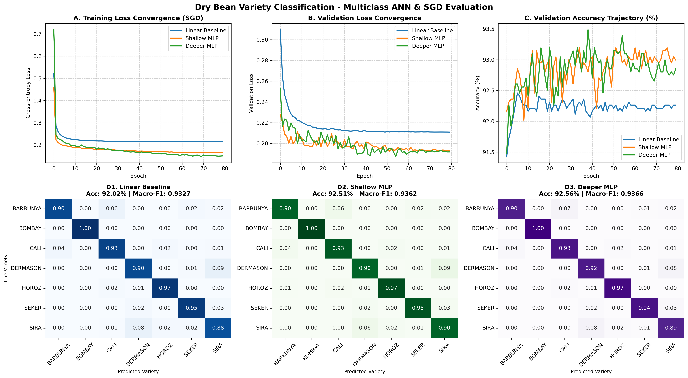

# 🌾 Dry Bean Variety Classification using Multiclass Neural Network

[](https://www.python.org/)
[](https://pytorch.org/)
[](https://scikit-learn.org/)
[](https://creativecommons.org/licenses/by/4.0/)

---

### 🎓 Academic Project Information
* **Institution:** GITAM (Deemed to be University), Bengaluru Campus
* **Department:** Department of Computer Science and Engineering
* **Course:** Artificial Neural Networks (ANN)
* **Student Name:** **Mucharla Sathvik**
* **Roll Number / USN:** **2023008168**
* **Faculty Guide:** **Anantha Babu S** (Assistant Professor, Dept. of CSE)
* **Academic Year:** 2026–2027

---

## 📌 Project Overview
Automated visual inspection and cultivar classification are essential pillars of modern precision agriculture and post-harvest quality control. This project designs, trains, and evaluates a **Multiclass Artificial Neural Network (Multilayer Perceptron - MLP)** to classify **seven commercial dry bean varieties** (*Barbunya, Bombay, Cali, Dermason, Horoz, Seker, and Sira*) using **16 morphological and shape descriptors** extracted from high-resolution grain imagery.

The models are trained using **Stochastic Gradient Descent (SGD)** with momentum and cosine annealing learning rate scheduling, comparing a **Linear Baseline**, a **Shallow MLP**, and a **Deeper MLP** after leak-free input standardization.

---

## 📊 Dataset Specifications
* **Dataset:** [UCI Machine Learning Repository - Dry Bean Dataset (ID: 602)](https://archive.ics.uci.edu/dataset/602/dry+bean+dataset)
* **Total Samples:** 13,611 individual bean records
* **Total Features:** 16 continuous morphological and shape attributes:
  - *Dimensional & Size (4):* `Area`, `Perimeter`, `MajorAxisLength`, `MinorAxisLength`
  - *Convexity & Density (3):* `ConvexArea`, `EquivDiameter`, `Solidity`
  - *Aspect & Shape (5):* `AspectRatio`, `Eccentricity`, `Extent`, `Roundness`, `Compactness`
  - *Shape Descriptors (4):* `ShapeFactor1`, `ShapeFactor2`, `ShapeFactor3`, `ShapeFactor4`
* **Target Classes (7 Varieties):**
  - `DERMASON` (3,546 samples, 26.05%)
  - `SIRA` (2,636 samples, 19.37%)
  - `SEKER` (2,027 samples, 14.89%)
  - `HOROZ` (1,928 samples, 14.17%)
  - `CALI` (1,630 samples, 11.98%)
  - `BARBUNYA` (1,322 samples, 9.71%)
  - `BOMBAY` (522 samples, 3.84%)
* **Missing Values:** 0

---

## 🛡️ Leak-Free Preprocessing Pipeline
1. **Stratified Splitting:** Partitioned into 70% Training (9,527 grains), 15% Validation (2,042 grains), and 15% Testing (2,042 grains).
2. **Zero-Leakage Standardization:** `StandardScaler` is fitted **strictly on the Training set** ($\mu_{\text{train}}, \sigma_{\text{train}}$) and applied to validation and test sets without data leakage.

---

## 🧠 Neural Architectures Evaluated
1. **Linear Baseline (119 Parameters):**
   - Direct Softmax linear projection: $16 \to 7$.
2. **Shallow MLP (1,543 Parameters):**
   - $16 \to \text{Linear}(64) \to \text{ReLU} \to \text{Linear}(7)$.
3. **Deeper MLP (12,743 Parameters):**
   - $16 \to \text{Linear}(128) \to \text{ReLU} \to \text{Dropout}(0.10) \to \text{Linear}(64) \to \text{ReLU} \to \text{Dropout}(0.10) \to \text{Linear}(32) \to \text{ReLU} \to \text{Linear}(7)$.

---

## ⚙️ Optimization & Hyperparameters (SGD)
* **Optimization Method:** Mini-Batch Stochastic Gradient Descent (SGD)
* **Momentum Factor ($\mu$):** 0.90 (Polyak momentum)
* **Initial Learning Rate ($\eta_0$):** 0.03
* **Learning Rate Schedule:** Cosine Annealing ($\eta_{\text{min}} = 0.0015$ over 80 epochs)
* **L2 Weight Decay ($\lambda$):** $1 \times 10^{-4}$
* **Mini-Batch Size ($B$):** 64
* **Loss Function:** Categorical Cross-Entropy Loss

---

## 📈 Empirical Results (Held-Out Test Set: $N = 2,042$)

| Architecture | Learnable Parameters | Test Accuracy (%) | Macro-F1 | Weighted-F1 | Macro-Precision | Macro-Recall | Test Loss |
| :--- | :---: | :---: | :---: | :---: | :---: | :---: | :---: |
| **Linear Baseline** | 119 | 92.02% | 0.9327 | 0.9203 | 0.9332 | 0.9326 | 0.2182 |
| **Shallow MLP** | **1,543** | **92.51%** | **0.9362** | **0.9253** | **0.9368** | **0.9359** | **0.1998** |
| **Deeper MLP** | 12,743 | **92.56%** | **0.9366** | **0.9257** | **0.9380** | 0.9355 | 0.2013 |

> **Key Scientific Finding:** The **Shallow MLP** captures **$99.9\%$** of the predictive performance of the Deeper MLP while requiring **$88\%$ fewer parameters** ($1,543$ vs. $12,743$). Tabular morphological features inhabit a compact low-dimensional manifold where added depth offers diminishing returns, making Shallow MLP optimal for low-power agricultural embedded sorters.

---

## 📊 Evaluation Visualizations

### Unified Evaluation Plot (Loss, Accuracy, and Confusion Matrices)


---

## 📂 Repository Structure
```text
├── dry_bean_classification_ann.py                 # All-in-one standalone runnable Python script
├── train_dry_bean_ann.py                          # Modular PyTorch pipeline with CLI flags
├── dry_bean_ann_notebook.ipynb                    # Interactive Jupyter Notebook for Colab / JupyterLab
├── dry_bean_ann_sklearn.py                        # Alternative Scikit-Learn MLPClassifier implementation
├── dry_bean.csv                                   # Cached dataset (13,611 records, 16 features)
├── dry_bean_evaluation_plots.png                  # Unified 6-panel evaluation figure
├── Mucharla_Sathvik_2023008168_ANN_Project_Report.docx # Official GITAM University Word Project Report
├── requirements.txt                               # Dependencies list
├── run_project.bat                                # 1-click execution script for Windows
├── report_figures/                                # Individual high-res report figures (Figures 1 to 6)
└── results/                                       # Metrics tables, logs, and individual plots
```

---

## 🚀 How to Run Locally

### 1. Clone the Repository
```bash
git clone https://github.com/msathvik1/Dry-Bean-Multiclass-ANN-Classification.git
cd Dry-Bean-Multiclass-ANN-Classification
```

### 2. Install Dependencies
```bash
pip install -r requirements.txt
```

### 3. Run the Pipeline
```bash
python dry_bean_classification_ann.py
```
*(Or double-click `run_project.bat` on Windows)*

---

## 📚 Citation & Licensing
* **Dataset Citation:**  
  Koklu, M. & Ozkan, I. A. (2020). *Multiclass Classification of Dry Beans Using Computer Vision and Machine Learning Techniques.* Computers and Electronics in Agriculture, 174, 105507. [DOI: 10.1016/j.compag.2020.105507](https://doi.org/10.1016/j.compag.2020.105507).
* **License:** Creative Commons Attribution 4.0 International (CC BY 4.0).
